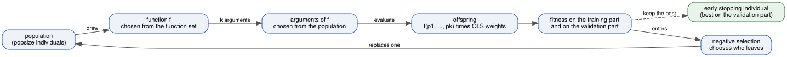
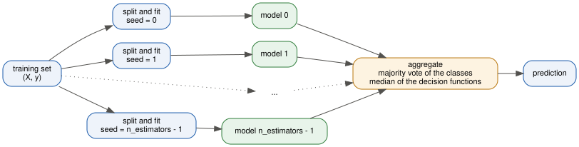

This page describes the method. It follows the structure of the first EvoDAG paper (see [Citing](citing.qmd)).

## Semantics and the target vector

EvoDAG learns from a training set of $n$ pairs $(x_i, y_i)$. Fix the order of the examples and write $\mathbf{t} = (y_1, \dots, y_n)$ for the *target vector*. Every individual $p$ (a function of the inputs) is represented by its *semantics*

$$
\mathbf{p} = \bigl(p(x_1), \dots, p(x_n)\bigr) \in \mathbb{R}^n ,
$$

the values that it takes on the training examples. Everything the search needs about an individual is that vector; the expression that produced it is never evaluated again.

For regression the target vector is the vector of responses. For classification with $K$ classes the problem is split one class against the others: there are $K$ target vectors, each one with $+1$ for the examples of that class and $-1$ for the rest, and an individual has one semantics vector per class. Prediction takes the class with the largest value.

## An individual is a node of a graph

All the individuals ever created are stored in one list (the *history*). An individual is a node that records

* the positions, in that list, of the individuals it was computed from (for an input variable, which column of $X$ it reads),
* its coefficients, found when it was created,
* its semantics, its height (the longest path down to an input), and its fitness on the training part and on the validation part.

Because different nodes can point at the same earlier node, the object that results is a directed acyclic graph and not a tree, which is where the name comes from. A model is the sub-graph reachable from one node.

## Creating an offspring: PrXO

To create an offspring EvoDAG draws a function $f$ from the function set and selects its $k$ arguments $p_1, \dots, p_k$ from the population. It then computes the best coefficients that the target vector allows.

When $f$ is the sum the offspring is a linear combination of the arguments,

$$
o = \sum_{j=1}^{k} \alpha_j \, p_j ,
$$

and for any other function the offspring is a scaled copy of its result,

$$
o = \alpha \, f(p_1, \dots, p_k) .
$$

The coefficients are those of ordinary least squares: they minimise the squared distance between the offspring's semantics and the target,

$$
\boldsymbol{\alpha} = \arg\min_{\boldsymbol{\alpha}}
\Bigl\lVert \mathbf{t} - \sum_j \alpha_j \mathbf{p}_j \Bigr\rVert^2
= (P^{\top} P)^{-1} P^{\top} \mathbf{t},
\qquad P = [\mathbf{p}_1 \; \cdots \; \mathbf{p}_k] ,
$$

so $o$ is the orthogonal projection of $\mathbf{t}$ onto the space spanned by the arguments. This operator is called PrXO, from *projection crossover*. It generalises the geometric semantic crossover of Moraglio and collaborators, $o = r\,p_1 + (1-r)\,p_2$ with $r$ in $[0, 1]$, by dropping the restriction on the coefficients and letting the data choose them. The operator acts at the root: the offspring is a new node placed on top of existing ones. Nothing below it is changed or re-evaluated, so creating an offspring costs time proportional to $n$.

How the code computes the coefficients:

* The system $P^{\top}P\,\boldsymbol\alpha = P^{\top}\mathbf{t}$ is solved by Gauss–Jordan elimination. If it is singular or the numbers are not finite, the candidate is thrown away and another one is drawn.
* Only the examples selected by the training mask take part in the sums (see [the validation split](#early-stopping-and-the-validation-split)).
* For a function with several outputs (classification) the coefficients are computed once per class against that class's target vector.
* Three functions are *classifiers* and do not use least squares: they are built directly from the class labels of the training part. `NaiveBayes` fits a Gaussian Naive Bayes whose features are the semantics of its arguments (a mean and a variance per class and per argument), `NaiveBayesMN` is the multinomial version of it, and `Centroid` computes the centroid of each class and outputs minus the squared distance to it. They exist only for classification.

### The function set

The function set is a list of functions with their number of arguments. The default set is in `default_parameters.json` (sum with up to 60 arguments, 20 for the product, and so on); the full catalogue of functions the code knows is in [Parameters](parameters.qmd). Which function is used next is not uniform: a tournament among a few randomly drawn functions (`fs_tournament_size`, 2 by default) picks the function whose offspring have had the best average fitness so far. When the average fraction of non-zero values in the population falls below `min_density` (0.8 by default), only the functions that keep sparse data sparse (the ones marked `density_safe` in the code) are drawn.

## Selecting the arguments

The arguments of a function are chosen by *tournament selection*: draw `tournament_size` individuals at random (2 by default) and keep the one with the best fitness. In the default configuration for classification the arguments are **not** chosen by fitness: for the sum, `NaiveBayes`, `NaiveBayesMN` and `Centroid` the first argument is drawn at random and each other argument is, among `tournament_size` individuals drawn at random, the one that agrees least with the first on the labels it predicts (`selection="agreement"`, see [Selection](selection.qmd)), and the arguments of the other functions are drawn at random. Regression, and `selection="fitness"`, use the tournament on fitness for every function. `random_generations` (0 in the classification file, 1 in the regression one) replaces the tournaments on fitness by uniform draws during the first generations, which diversifies the early population, so it only matters when the arguments are chosen by fitness. The sum, `Min`, `Max` and the three classifiers need distinct arguments: when a draw repeats one they retry a few times, and the candidate is dropped if fewer than two distinct arguments are left. The other functions retry as well but accept a repeated argument in the end. 

The [Selection](selection.qmd) page describes the heuristics that replace the fitness in this tournament, and which of them are in the code.

## Initial population

The population is not random trees. It is filled with individuals that only involve inputs. The default configuration first creates one node for each of the input functions applied to *all* the variables (`NaiveBayes`, `NaiveBayesMN` and `Centroid` for classification) and then individuals that are either a single input variable (with probability `pr_variable`) or an input function applied to a few variables. Each input is used once, until none is left (`all_inputs`) or the population has `popsize` individuals. If the population is still not full, the rest is made by the offspring procedure above. 

## Steady-state evolution

After the initial population EvoDAG is *steady state*: every step creates one offspring and inserts it in place of one existing individual, chosen by a *negative* tournament that returns the worst of `tournament_size` random individuals when `negative_selection` is true. The default configuration for classification sets it to false, and then the victim is chosen at random; the default for regression is the negative tournament. An alternative `population_class`, `Generational`, builds `popsize` offspring and then replaces the whole population at once.

Offspring are discarded, and a new one is drawn, if their semantics are not finite, if their coefficients cannot be computed, or, with `unique_individuals`, if the same function was already applied to the same arguments.

### Fitness

For classification the default fitness is the macro-averaged F1 score (the mean over the classes of the F1 of each class). Macro-F1 gives every class the same weight, so a classifier cannot score well by ignoring the classes with few examples, which is what happens with the accuracy when the classes are imbalanced. For regression the fitness on the training part is minus the sum of absolute errors. `fitness_function` selects other measures for classification (accuracy, macro F1, precision and recall variants).

## Early stopping and the validation split

PrXO fits the training data very closely, so a long run overfits. Instead of shrinking the population EvoDAG holds part of the training data out as a *validation set* and tracks, along the run, the individual that is best on it: the *early stopping individual*. The evolution stops when `early_stopping_rounds` offspring have been generated without improving that individual, or the validation error reaches zero, or `time_limit` seconds have passed, or a given number of `generations` has been completed. The model that the run returns is the early stopping individual.

The split is controlled by `tr_fraction` (0.5 by default):

* In classification with the default fitness the validation set is `floor(n (1 - tr_fraction))` examples drawn at random from the $n$ training examples, and the draw is repeated until every class is present in the training part; everything else is the training part. The coefficients are then computed on a random subsample of the training part: for each one-against-the-rest problem it takes `tr_fraction` times the size of the smaller side from each side.
* In regression a fraction `tr_fraction` of the examples is the training part and the rest is the validation part. The validation fitness is the negative squared error relative to the variance of the validation targets.

The split and the subsample are drawn at random from the seed, so two runs with different seeds learn from different views of the same data.

## The model

A `Model` keeps only the nodes needed by the early stopping individual and their coefficients, in the order in which they must be evaluated. To predict new data it evaluates the nodes in that order with the new inputs, and drops intermediate results as soon as it is done. The training data are not stored, and neither is the rest of the population.

## The ensemble

A single run can still be unlucky or overfit, so the recommended use is an ensemble.

Each member is the same procedure with a different seed (the seed of the ensemble plus the position of the member). Since the validation split, the subsample used for the coefficients, the initial population and every random choice depend on the seed, the members make different mistakes. The members are trained independently, so they can be trained in parallel (`n_jobs`).

The ensemble aggregates the members as follows:

* classification: each member predicts the class with the largest output and the ensemble returns the class that most members chose; `predict_proba` is the proportion of the members that voted for each class;
* the decision function of the ensemble, in classification and in regression, is the element-wise median of the members' outputs; `predict` for regression returns it.

## Searching the parameter space

EvoDAG has many parameters. Rather than tune them by hand you can sample configurations at random from the sets in `parameter_values.json`, train the model with each of them three times (three seeds), and keep the configuration with the best median validation fitness. This is what `EvoDAG-params` does; see [Parameters](parameters.qmd) and [Command line](cli.qmd). A plain random search is justified with the result of Bergstra and Bengio that random search usually beats a hand-made grid.
